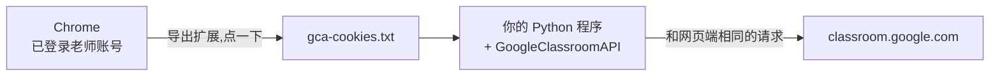

# GoogleClassroomAPI

用 Python 按老师的思路操作 Google Classroom:课程、学生、主题、作业、提问、资料、公告、评分。
也能以学生的身份交作业和答题,所以"老师发布 → 学生完成 → 老师读到答案 → 发还成绩"这一整圈可以全程用代码跑。

**只需要老师浏览器里导出的 Cookie**:不用 OAuth 客户端,不用 Google Cloud 项目,运行时也不需要浏览器。
Google 网页端内部的协议(RPC 编号、位置数组、字段掩码、会话参数)都封装在库里。

> **非官方。** 本库调用的是 Google Classroom 网页应用自己使用的私有接口,是逆向得到的。
> Google 没有为它们提供文档,也不承诺兼容,随时可能失效;自动化调用也可能不符合 Google 的服务条款。
> 请先用测试账号和测试班级,风险自担。本项目与 Google 无关。

**目录**:[配置](#配置) · [使用](#使用) · [学生这一侧](#学生这一侧和完整的一轮) · [返回值速查](#返回值速查) · [出错时](#出错时) ·
[验证到什么程度](#验证到什么程度) · [做不了的和还没做的](#做不了的和还没做的以及原因) · [测试](#测试)

## 配置

整个流程只有一条线:在已登录的 Chrome 里把 Cookie 导出成一个文件,之后你的程序拿着这个文件直接和 Classroom 通信。



### 第 1 步:准备

- Python 3.10 或更高。
- Chrome,并且已经登录老师的 Google 账号(打开 <https://classroom.google.com> 能看到自己的班)。
- 强烈建议先建一个**测试班**,拉一个测试学生账号进去。下面的例子都可以先在测试班里跑。

### 第 2 步:安装

```bash
git clone https://github.com/Felix3322/GoogleClassroomAPI.git
cd GoogleClassroomAPI
pip install -e .
```

库本身只依赖 `httpx`。只想装库、不要源码也可以:

```bash
pip install git+https://github.com/Felix3322/GoogleClassroomAPI.git
```

不过第 3 步要用的导出扩展在仓库的 `tools/cookie-export/` 目录里,所以仓库还是得下载一次。

### 第 3 步:导出 Cookie

Google 的登录 Cookie 网页脚本读不到,只能用浏览器扩展导出。仓库自带一个很小的扩展,它只在本机读 Cookie、写成文件,不联网
(代码只有一个文件:`tools/cookie-export/background.js`,可以自己看)。

1. Chrome 地址栏打开 `chrome://extensions`,打开右上角的**开发者模式**。
2. 点**加载已解压的扩展程序**,选仓库里的 `tools/cookie-export` 文件夹。
3. 点工具栏上这个扩展的图标(在拼图图标里,可以先固定到工具栏)。
4. 在弹出的保存对话框里,把 `gca-cookies.txt` 存到**仓库之外**的地方。
5. 看图标上的角标:

| 角标 | 意思 |
|---|---|
| 绿色数字 | 导出完整,可以用了 |
| 黄色 `!` | 文件写了,但登录不完整;在这个 Chrome 里把账号重新登录好,再导一次 |
| 红色 `0` 或 `err` | 什么都没读到 |

扩展装一次就行,以后每次重新导出只需要第 3、4 两步。

> **这个 Chrome 同时登录了好几个 Google 账号时**,导出的文件里包含所有这些账号。库默认用 0 号账号;
> 要用别的账号,打开时传 `account=<序号>`,序号就是该账号的 Classroom 地址栏里 `/u/` 后面的数字
> (`classroom.google.com/u/3/…` 就是 3)。`cls.me()` 会告诉你现在用的是谁;序号对不上时库会报错,不会悄悄换成 0 号账号。

### 第 4 步:确认配置好了

仓库里的示例脚本会读课程和学生、建一份**草稿**作业(学生看不到)、把它列出来、再删掉。参数是 Cookie 文件和这门课的任意一个链接:

```bash
python examples/classroom_quickstart.py gca-cookies.txt "https://classroom.google.com/c/你的课程链接"
```

配置正确时输出是这样的:

```text
course:   {'course_id': '123456789012', 'name': '七年级数学', 'section': 'G7'}
student:  张三 zhangsan@example.com
draft:    {'item_id': '…', 'course_id': '123456789012', 'title': 'GoogleClassroomAPI demo 1795396583', 'state': 3}
listed:   [{'item_id': '…', 'kind': 'assignment', 'title': 'GoogleClassroomAPI demo 1795396583', 'state': 3, …}]
deleted:  True
```

如果报 `ReauthRequired`,说明 Cookie 没导完整或已经过期,回到第 3 步重新导出。

### Cookie 的保管和有效期

- **这个文件等于账号的完整登录状态**(不只是 Classroom),拿到它的人就等于登录了这个账号。请当密码保管,不要发给别人,
  不要提交进任何仓库(本仓库的 `.gitignore` 已经排除了 `*cookies*.txt`)。
- 想让一份已经导出的文件作废:在浏览器里退出这个 Google 账号。按 Google 的机制,退出会让这次登录的 Cookie 一并失效
  (这一点本项目没有专门实测过)。
- **导出的 Cookie 大约两小时后失效**,而浏览器里的账号仍然是登录状态(浏览器会不断换新的会话令牌,导出的快照跟不上)。
  实测过两份:一份是用了大约两小时后发现失效;另一份每 10 分钟检查一次,导出后约 113 分钟时还能用,约 123 分钟时已经失效。
  失效后库会抛出 `ReauthRequired`,重新导出一份(点一下扩展)即可。
- **没有办法在浏览器之外给它续期。** 对照实验:同一份导出复制成两份,一份每 10 分钟按浏览器的做法请求一次新令牌
  (`WebSession.renew()`),另一份从不续。失效之前续了 12 次,请求都被接受,但一次新令牌也没发下来,两份在同一次检查时都已失效。
  所以需要长时间运行的程序,只能定期重新导出。`renew()` 和 `renew_every=` 仍留在库里,但不要指望它们。

## 使用

下面的代码可以从上到下依次运行。凡是 `publish=False` 的都只建草稿,学生看不到;不写这个参数就是**立刻发布给全班**。

### 打开

```python
from google_classroom_api import Classroom

cls = Classroom.from_cookie_file("gca-cookies.txt")

# 课程 id 就藏在这门课的任何一个链接里
course = Classroom.course_id_from_url("https://classroom.google.com/c/MTIzNDU2Nzg5MDEy")   # -> 123456789012
```

不知道链接也行,直接列出来挑:

```python
for c in cls.courses():
    print(c["course_id"], c["name"], c["section"])
```

所有 id 返回时都是字符串;传回给库时字符串或整数都可以。

### 课程和学生

```python
cls.course(course)       # {"course_id": "123456789012", "name": "七年级数学", "section": "G7"}
cls.students(course)     # [{"user_id": "…", "name": "张三", "email": "…", "photo_url": "…"}, …]
```

### 主题

```python
topic = cls.ensure_topic(course, "第一单元")                  # 已有同名主题就复用,没有才新建
cls.rename_topic(course, topic["topic_id"], "第一单元 分数")
cls.topics(course)                                           # [{"topic_id": "…", "name": "第一单元 分数", "updated_ms": …}, …]

unused = cls.ensure_topic(course, "用不上的主题")
cls.delete_topic(course, unused["topic_id"])                 # 主题下的帖子不会被删,只是不再属于任何主题
```

### 作业

```python
from datetime import datetime, timedelta, timezone

a = cls.create_assignment(
    course, "第 12 课 分数",
    instructions="完成表单后提交。",
    points=10,
    topic="第一单元 分数",                                         # 按名字找主题,没有就新建
    due=datetime.now(timezone.utc) + timedelta(days=7),           # 截止时间,必须带时区
    form_url="https://docs.google.com/forms/d/<表单文件 id>/edit",   # 可选:附一份 Google 表单
    link_urls=["https://example.com/reading"],                    # 可选:附普通链接
    publish=False,                                                # 先存草稿
)
# a == {"item_id": "…", "course_id": "…", "title": "第 12 课 分数", "state": 3}     state: 2 已发布,3 草稿

cls.update_assignment(course, a["item_id"], points=20)                         # 只改分值
cls.update_assignment(course, a["item_id"], "第 12 课 分数(修订)", due=None)    # 改标题,并去掉截止日期
cls.publish(course, a["item_id"])                                              # 把草稿原样发布给全班
cls.item(course, a["item_id"])                                                 # 读回这一条的全部字段
cls.assignments(course)                                                        # 全部作业和草稿
cls.delete_assignment(course, a["item_id"])
```

几点说明:

- **`update_*` 只改你传的参数,其余原样保留**,附件也在。想清掉主题或截止日期,显式传 `topic=None` / `due=None`。
- **表单链接要用带文件 id 的那种**:`https://docs.google.com/forms/d/<文件 id>/edit`,就是编辑表单时地址栏里的链接。
  实测 Classroom 不把公开填写链接(`…/forms/d/e/…/viewform`)认作表单,只当普通网页;传了这种链接库会报错并说明原因,
  不会悄悄把表单当成普通链接附上去,也不会留下半成品草稿。
- 只要日期、不要具体时间的截止日期:传当天 23:59(老师所在时区)那一刻,并加上 `due_has_time=False`。
- 发给**指定的几个学生**还做不了,见[做不了的和还没做的](#做不了的和还没做的以及原因);传 `student_ids` 会直接报错,不会误发给全班。

### 提问

```python
q = cls.create_question(course, "1/2 和下面哪个相等?", choices=["2/4", "2/3"], points=5, publish=False)   # 给了 choices 就是单选题
s = cls.create_question(course, "用一句话说明什么是约分。", publish=False)                               # 不给就是简答题

cls.update_question(course, s["item_id"], choices=["会", "不会"])     # 改成单选题,其余保留
cls.questions(course)                                                # 每条带 "choices":单选题是选项列表,简答题是 None
cls.publish(course, q["item_id"])
cls.delete_question(course, q["item_id"])
cls.delete_question(course, s["item_id"])
```

### 资料

```python
m = cls.create_material(course, "预习阅读", description="课前读完。", topic="第一单元 分数",
                        link_urls=["https://example.com/reading"], publish=False)
cls.update_material(course, m["item_id"], description="课前读完第 3 节。")
cls.publish(course, m["item_id"])
cls.materials(course)
cls.delete_material(course, m["item_id"])
```

### 公告

```python
n = cls.create_announcement(course, "明天带量角器。", publish=False)      # 存进草稿箱
cls.announcements(course, drafts=True)                                 # 草稿箱里的
cls.update_announcement(course, n["item_id"], "明天带量角器和圆规。")
cls.publish(course, n["item_id"])
cls.announcements(course)                                              # 已经发到信息流里的
cls.delete_announcement(course, n["item_id"])
```

### 把课业列出来

```python
for row in cls.classwork(course):        # 作业、提问、资料,连同草稿,按主题分区
    status = "已发布" if cls.is_published(row) else "草稿"
    print(row["kind"], row["title"], status, row["points"], row["due"])
```

### 评分和发还

```python
quiz = cls.create_assignment(course, "随堂小测", points=10)        # 不写 publish=False:直接发布
student = cls.students(course)[0]["user_id"]

cls.set_draft_grade(course, quiz["item_id"], student, 8)          # 草稿分:只有老师看得到
cls.return_work(course, quiz["item_id"], student)                 # 发还:学生这时才看到 8 分
for s in cls.submissions(course, quiz["item_id"]):
    print(s["student_id"], s["state"], s["grade"], s["draft_grade"])   # … returned 8 8
cls.delete_assignment(course, quiz["item_id"])
```

`return_work(..., grade=9)` 可以一步完成打分和发还;`grade=None` 是不给分数直接发还。
`return_work_many(course, item_id, {学生 id: 分数, …})` 给一份作业的多名学生发还(每名学生一次请求)。
`clear_draft_grade` 清掉还没发还的草稿分。

### 学生这一侧,和完整的一轮

同一个导出文件里如果还登录着一个学生账号,就可以让库以学生的身份交作业、答题。下面假设学生是 3 号账号:

```python
import time

teacher = Classroom.from_cookie_file("gca-cookies.txt")               # 默认的 0 号账号:老师
student = Classroom.from_cookie_file("gca-cookies.txt", account=3)    # 3 号账号:学生
student.me()                                                          # {"email": "…", "user_id": "…"}

hw = teacher.create_assignment(course, "闭环示例 作业", points=10)
ask = teacher.create_question(course, "闭环示例 1/2 和哪个相等?", choices=["2/4", "2/3"], points=5)
time.sleep(3)                                                # 学生的提交记录在发布后一两秒才出现

student.my_submission(course, hw["item_id"])["state"]        # "assigned"
student.turn_in(course, hw["item_id"])                       # 标记为已完成
student.unsubmit(course, hw["item_id"])                      # 取消提交
student.add_link(course, hw["item_id"], "https://example.com/my-work")     # 交之前可以先加附件:链接
student.add_new_doc(course, hw["item_id"])                                # 或让 Classroom 在学生的云端硬盘里新建一份文档
student.turn_in(course, hw["item_id"])                       # 再交一次,附件随提交记录一起
student.answer_question(course, ask["item_id"], "2/4")       # 答题并上交;简答题就传一段文字

for s in teacher.submissions(course, ask["item_id"]):        # 老师读到每个学生的状态和答案
    print(s["student_id"], s["state"], s["answer"])          # … turned_in 2/4
for s in teacher.submissions(course, hw["item_id"]):         # 以及学生交上来的附件
    print([(a["kind"], a["title"], a["url"]) for a in s["attachments"]])
teacher.question_summary(course, ask["item_id"])             # {"2/4": 1, "2/3": 0}

me = student.me()["user_id"]
teacher.return_work(course, hw["item_id"], me, grade=9)      # 发还并给 9 分
student.my_submission(course, hw["item_id"])["grade"]        # 9

teacher.delete_assignment(course, hw["item_id"])
teacher.delete_question(course, ask["item_id"])
```

几点说明:

- 学生端的方法只对"自己的"作业起作用。实测老师替学生交作业会被服务器拒绝。
- 服务器不检查单选题的答案是不是选项之一(实测随便一段文字都会被存下来),所以 `answer_question` 会先核对,不在选项里就报错。
- 学生可以加的附件:链接(`add_link`)、新建的 Google 文件(`add_new_file`,`"doc"` 文档 / `"slides"` 幻灯片 / `"sheet"` 表格 /
  `"drawing"` 绘图;`add_new_doc` 是文档的简写)、云端硬盘里已有的文件(`add_drive_file`,传文件 id)。`remove_attachment` 按附件 id 移除。
- **从电脑上传文件做不了**:网页端的"文件"选项打开的是 Google 云端硬盘自己的上传窗口,文件先传到云端硬盘,Classroom 只拿到文件 id;
  而导出的 Cookie 在浏览器之外进不了云端硬盘(实测被要求重新登录)。文件如果已经在学生的云端硬盘里,用 `add_drive_file` 按 id 附上即可。
- 附件要在上交之前加:实测交了之后再加会被服务器拒绝,先 `unsubmit` 才行。
- `add_drive_file` 只能加学生自己还能编辑的文件;已经随别的作业交上去的文件实测会被拒绝。
- 老师在学生上交之前就能读到他已经加上的附件。
- 每次调 `add_new_file` / `add_new_doc` 都会在学生的云端硬盘里真的新建一份文件;实测删除作业之后这份文件还在。

### 评论

```python
talk = teacher.create_assignment(course, "评论示例", points=1)
time.sleep(3)

# 课程评论:作业下面全班都看得到的评论
c1 = student.add_class_comment(course, talk["item_id"], "这题要写过程吗?")
teacher.add_class_comment(course, talk["item_id"], "要写。")
teacher.class_comments(course, talk["item_id"])            # [{"comment_id", "author_id", "text", …}],新的在前
teacher.delete_class_comment(course, talk["item_id"], c1["comment_id"])    # 老师可以删学生的评论

# 私下评论:只有这名学生和老师看得到,挂在这名学生的这份作业上
student.add_private_comment(course, talk["item_id"], "老师,我第 3 题不会。")                # 学生写给老师
teacher.add_private_comment(course, talk["item_id"], "看课本第 12 页。", student_id=me)     # 老师回给这名学生
teacher.private_comments(course, talk["item_id"], me)      # 老师读某个学生的私下评论
mine = student.private_comments(course, talk["item_id"])   # 学生读自己的
student.delete_private_comment(course, talk["item_id"], mine[-1]["comment_id"])   # 学生删掉自己最早那条

teacher.delete_assignment(course, talk["item_id"])
```

- 学生删掉的评论,学生自己看不到了,老师加上 `include_deleted=True` 仍然读得到(网页端也是这么告诉学生的)。
- 学生不能删老师的评论(实测被服务器拒绝)。

### 缺交作业的默认成绩

```python
before = cls.missing_work_grade(course)                            # {"enabled": False, "percent": 0.0}
cls.set_missing_work_grade(course, enabled=True, percent=50)       # 缺交的作业自动记 50%
cls.set_missing_work_grade(course, enabled=before["enabled"], percent=before["percent"])   # 改回去
```

## 返回值速查

| 方法 | 返回 |
|---|---|
| `courses()` / `course()` | `{"course_id", "name", "section"}` |
| `students()` | `{"user_id", "name", "email", "photo_url"}` |
| `topics()` / `ensure_topic()` | `{"topic_id", "name", "updated_ms"}` |
| `create_*()` / `update_*()` / `publish()` | `{"item_id", "course_id", "title", "state"}` |
| `classwork()` / `assignments()` / `questions()` / `materials()` / `announcements()` / `item()` | `{"item_id", "kind", "title", "text", "state", "topic_id", "points", "due", "due_has_time", "attachment_ids"}`,提问另有 `"choices"` |
| `submissions()` / `my_submission()` / `turn_in()` / `unsubmit()` / `answer_question()` / `return_work()` / `set_draft_grade()` | 提交记录:`{"student_id", "item_id", "state", "state_code", "updated_ms", "turned_in_ms", "answer", "answer_type", "attachments", "grade", "draft_grade", "grade_history", "raw"}` |
| `question_summary()` | `{选项: 选它的人数}` |
| `me()` | `{"email", "user_id"}` |
| `class_comments()` / `private_comments()` / `add_*_comment()` / `delete_*_comment()` | 评论:`{"comment_id", "kind", "student_id", "author_id", "text", "html", "created_ms", "updated_ms", "deleted", "raw"}` |
| `missing_work_grade()` | `{"enabled", "percent"}` |

字段含义:

条目(作业、提问、资料、公告):

- `state`:`2` 已发布,`3` 草稿。
- `kind`:`"assignment"` 作业、`"question"` 提问、`"material"` 资料、`"announcement"` 公告。
- `text`:作业和提问的说明、资料的描述、公告的正文。公告没有标题,`title` 是空字符串。
- `due`:带时区(UTC)的 `datetime`,没有截止日期时是 `None`;`points` 是满分。资料和公告没有这两项,为 `None`。
- `attachment_ids`:附件的 id 列表。目前只能读到 id,读不到附件指向的链接。

评论:`kind` 是 `"class"`(课程评论)或 `"private"`(私下评论);私下评论的 `student_id` 是它所在的那份作业的学生,
课程评论为 `None`;`author_id` 是写评论的人;列表按新的在前。

提交记录(作业或提问发布时已经在班里的学生各有一条,发布后一两秒出现。实测在学生进班之前就发布的作业,
这个学生没有记录,要等老师给他打了分之类的事情发生后才有):

- `state`:`"assigned"` 已布置、`"turned_in"` 已上交、`"unsubmitted"` 学生取消了提交、`"returned"` 老师已发还。
  `state_code` 是服务器的原始编号(依次是 4、2、5、3)。
- `answer`:学生对提问的回答(简答题是文字,单选题是选中的选项),作业为 `None`;`answer_type` 是 `1` 简答 / `2` 单选。
- `grade`:学生看得到的成绩,发还时才有;`draft_grade`:老师的草稿分,学生读自己的记录时这一项是 `None`。
- `turned_in_ms`:上交时间(毫秒时间戳)。
- `attachments`:学生加的附件,`[{"attachment_id", "kind", "title", "url", "drive_id", "mime_type"}]`;
  `kind` 是 `"link"` 或 `"drive_file"`,链接没有 `drive_id`。老师和学生本人都读得到。
- `grade_history`:`[{"grade", "max_points", "time_ms", "by_user_id", "returned"}]`,只有老师读得到;
  `returned` 为真的那一条是随发还一起给出的成绩。

## 出错时

```python
from google_classroom_api import ReauthRequired, StreamItemRejected, WebProtocolError

try:
    cls.courses()
except ReauthRequired:
    ...     # Cookie 过期或不完整:重新导出一份
except StreamItemRejected as refused:
    ...     # Classroom 拒绝了这次写入,什么都没改;refused.status 是服务器给的状态
except WebProtocolError:
    ...     # 服务器的回复和逆向时不一样了:多半是 Google 改了协议
```

| 异常 | 什么时候 |
|---|---|
| `ReauthRequired` | Cookie 过期或不完整,被 Google 重定向去登录 |
| `StreamItemRejected` | 新建 / 修改 / 删除被服务器拒绝。Classroom 这时照样返回 HTTP 200,只在回复里带一个错误状态;库会检查它,不会把被拒绝的操作报告成成功 |
| `WebProtocolError` | 回复的格式和预期不符;表单链接不被认作表单;一个分区里超过 100 条(翻页还没做);`account=` 的序号下没有登录的账号;替别人交作业。`StreamItemRejected` 是它的子类 |
| `LookupError` | `item()` / `update_*()` / `publish()` 找不到这个 id(不存在或已删除) |
| `NotImplementedError` | 用了 `student_ids`(只发给指定学生,还没做) |
| `ValueError` | 截止时间没带时区;拿作业的 id 去调 `update_question` 之类;单选题的答案不在选项里 |

前三个都继承自 `ClassroomAPIError`,想一网打尽可以只捕获它。

## 验证到什么程度

- **真机验证**:用导出的 Cookie、在浏览器之外,用本库对真实的 Google Classroom 服务器发请求并读回结果确认。
  仓库里的 `tests/live` 就是这些验证,可以对你自己的测试班重跑。
- **未完成**:还没有弄清楚请求该怎么发,调用会报错。

| 能力 | 方法 | 状态 |
|---|---|---|
| 从链接取课程 id、列出全部课程、课程名称 | `course_id_from_url` / `courses` / `course` | 真机验证 |
| 花名册(学生 id、姓名、邮箱) | `students` | 真机验证 |
| 主题:列出 / 新建(按名字复用)/ 改名 / 删除 | `topics` / `ensure_topic` / `rename_topic` / `delete_topic` | 真机验证 |
| 作业:新建(整班)、主题、截止日期、分值、修改、发布、删除 | `create_assignment` / `update_assignment` / `publish` / `delete_assignment` | 真机验证 |
| 作业附 Google 表单、附链接 | `form_url=` / `link_urls=` | 真机验证 |
| 提问:简答 / 单选,新建、修改、发布、删除 | `create_question` / `update_question` / `publish` / `delete_question` | 真机验证 |
| 资料:新建(可附链接)、修改、发布、删除 | `create_material` / `update_material` / `publish` / `delete_material` | 真机验证 |
| 公告:新建、修改、发布、列出草稿和已发布的、删除 | `create_announcement` / `update_announcement` / `publish` / `announcements` / `delete_announcement` | 真机验证 |
| 列出课业(含草稿、分值、截止日期、附件 id),读单条 | `classwork` / `assignments` / `questions` / `materials` / `item` | 真机验证 |
| 草稿分:打分 / 读回 / 清空 | `set_draft_grade` / `submissions` / `clear_draft_grade` | 真机验证 |
| 发还作业:带分数 / 沿用草稿分 / 不给分数;给多名学生逐个发还 | `return_work` / `return_work_many` | 真机验证(多名学生只在一个学生的班里跑过) |
| 读每个学生的提交状态、对提问的回答、选项统计 | `submissions` / `question_summary` | 真机验证 |
| 学生端:读自己的提交、标记完成、取消提交、答简答题和单选题 | `my_submission` / `turn_in` / `unsubmit` / `answer_question` | 真机验证 |
| 学生端:加链接、新建文档 / 幻灯片 / 表格 / 绘图、加云端硬盘文件、移除附件;老师读到学生的附件 | `add_link` / `add_new_file` / `add_drive_file` / `remove_attachment` / `submissions` | 真机验证 |
| 评论:课程评论和私下评论的发表、列出、删除(老师、学生两边) | `add_class_comment` / `class_comments` / `add_private_comment` / `private_comments` / `delete_*_comment` | 真机验证 |
| 从导出文件里选用某一个账号 | `account=` / `me` | 真机验证 |
| 缺交作业默认成绩 开 / 关 / 百分比 | `missing_work_grade` / `set_missing_work_grade` | 真机验证 |
| 写入被服务器拒绝时报错 | `StreamItemRejected` | 真机验证 |
| **只发给指定学生** | `create_assignment(student_ids=...)` | **未完成**,调用会报错而不会误发给全班 |

验证用的测试班只有一个学生,所以凡是和"多个学生"有关的行为都没有覆盖到。

## 做不了的和还没做的,以及原因

**用 Cookie 做不了(已实测):**

- **Google 表单的内容。** 用导出不到半小时、Classroom 还照常能用的 Cookie,以表单主人的身份打开编辑页,会被当成没登录、退回到公开填写页;下载作答数据返回 401。
  所以表单的题目没法编辑、学生在表单里的作答也读不到(把现成的表单附到作业上不受影响,那走的是 Classroom)。
  **想只靠 Cookie 拿到逐题答案,可以用 Classroom 自带的提问**:一道题发一条提问,学生在 Classroom 里作答,用 `submissions()` 读每个人的答案。
  仓库里 `forms.py` / `formbuilder.py` / `oauth_backends.py` 是为以后走官方 API 保留的代码,当前对外接口不依赖它们。
- **学生从电脑上传文件。** 上传发生在 Google 云端硬盘的窗口里,导出的 Cookie 进不了云端硬盘。见"学生这一侧"里的说明。
- **给导出的 Cookie 续期。** 见"Cookie 的保管和有效期"。

**需要第二个学生才能做:**

- **只发给指定学生。** 网页端只有在班里至少有两个学生时才能表达"只发给其中几个",测试班只有一个学生,真实请求抓不到。
  也试过直接猜:把条目里疑似"受众"的字段写成九种不同的样子发布出去,服务器全都接受,但学生照样每份都看得到——那个字段不管用。
  所以传 `student_ids` 仍然会直接报错,不会误发给全班。
- **一次请求发还多名学生。** 同样抓不到。试过把两份作业的发还放进一个请求,被服务器拒绝;`return_work_many` 因此是每名学生发一次请求。

**还没做:**

- 提问编辑器里的三个勾选项(学生可以互相回复 / 可以修改答案 / 可以看全班汇总)保持默认,还不能改。
- 老师给作业附表单以外的云端硬盘文件。
- 翻页:一个主题分区、信息流、提交记录、评论各自超过 100 条时库会报错,而不是悄悄只返回前 100 条。

协议细节和每一项的验证记录见 [`docs/private-classroom-protocol.md`](docs/private-classroom-protocol.md)。

## 测试

```bash
pip install -e .[dev]
pytest                                   # 离线测试
```

离线测试只做两件事:把库生成的请求和**真实抓到的请求**逐字比对;把**真实服务器返回过的响应**喂给解析器。
没有自己编写的模拟服务器,所以它们能防止请求被改坏,但证明不了 Google 今天仍然这样工作。那要靠真机测试:

```bash
# Linux / macOS
GCA_COOKIE_FILE=gca-cookies.txt GCA_LIVE_COURSE_ID=<测试班的课程 id> pytest tests/live -k TestClassroom -v
```

```powershell
# Windows PowerShell
$env:GCA_COOKIE_FILE="gca-cookies.txt"; $env:GCA_LIVE_COURSE_ID="<测试班的课程 id>"; pytest tests/live -k TestClassroom -v
```

真机测试默认只在测试班里新建草稿(学生看不到)并随后删除、读写缺交成绩设置后恢复原值,会留下一个名为 `cfb live topic` 的主题;
测试班需要至少一名学生,草稿分那一项还需要一份已发布的作业(没有就跳过)。另外几个可选的环境变量:

| 环境变量 | 作用 |
|---|---|
| `GCA_LIVE_FORM_ID=<表单的文件 id>` | 连"附表单"一起验证 |
| `GCA_LIVE_PUBLISH=1` | 连"发布"一起验证。**会真的通知班里的学生**,只在没有真实学生的测试班里开 |
| `GCA_LIVE_STUDENT_ACCOUNT=<序号>` | 再加上 `-k "TestClassroom or TestTeacherAndStudent"`,跑"老师发布 → 学生完成 → 老师发还"的整圈。需要同一个浏览器里登录着测试班的一名测试学生,序号是他的 Classroom 地址栏里 `/u/` 后面的数字;同时要开 `GCA_LIVE_PUBLISH=1` |

## 许可

MIT,见 [LICENSE](LICENSE)。
